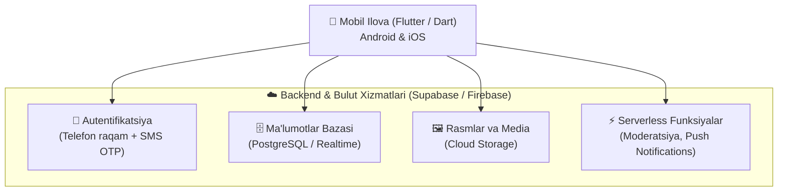
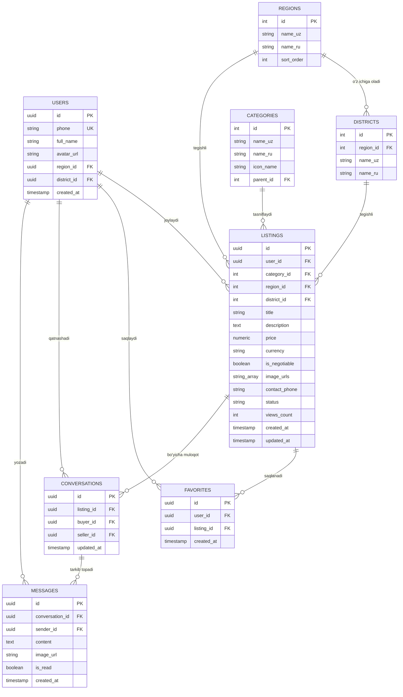
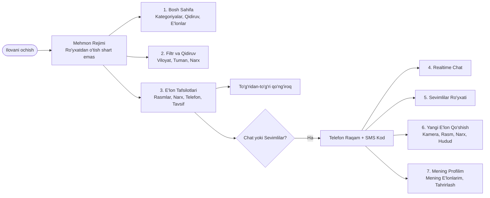

# Hayvonlar Savdosi Mobil Ilovasi (Animal Marketplace) — Arxitektura va Rivojlantirish Rejasi (PLAN.md)

Ushbu hujjat loyihaning to'liq texnik spetsifikatsiyasi, ma'lumotlar bazasi arxitekturasi, ekranlar xaritasi va bosqichma-bosqich amalga oshirish (roadmap) rejasini belgilaydi.
Boshlang'ich tahlil va kelishuvlar: [brainstorms/2026-10-16-hayvonlar-savdosi-ilovasi.md](file:///c:/Users/User/Desktop/n30/Animals/brainstorms/2026-10-16-hayvonlar-savdosi-ilovasi.md).

---

## 1. Loyiha Haqida Umumiy Ma'lumot

- **Loyiha nomi**: **Animals-uz** (O'zbekistonda Hayvonlar va Chorva Mollari Savdosi Platformasi)
- **Maqsad**: O'zbekiston aholisi va fermerlari uchun barcha turdagi hayvonlarni (uy jonivorlari va qishloq xo'jaligi hayvonlari) sotish va sotib olish bo'yicha qulay, sodda va tez ishlovchi mobil platforma yaratish.
- **Asosiy auditoriya**: 
  - Fermerlar va qishloq aholisi (qoramol, qo'y-qo'zi, ot, parrandalar);
  - Shahar aholisi va yoshlar (mushuk, it, qushlar, akvarium baliqlari).

> [!IMPORTANT]
> **MVP Asosiy Qoidasi**: Tizim sotuvchilar uchun maksimal sodda bo'lishi kerak. E'lon qo'yishda ortiqcha hujjatlar va byurokratik to'siqlar yo'q — faqat rasm, narx, telefon, tavsif va hudud.

---

## 2. Texnologik Stek (Technology Stack)

- **Frontend (Mobil)**: Flutter (Dart) — bitta kod bazasi orqali Android va iOS uchun yuqori unumdorlikdagi nativ ilova.
- **Arxitektura namunasi**: Clean Architecture + BLoC yoki Riverpod (State Management).
- **Backend**: Supabase (PostgreSQL, Realtime websocket, Storage, Auth) yoki Firebase.
- **Xaritalar va Hudud**: O'zbekistonning 14 ta hududi (viloyatlar) va 200+ tumanlari bo'yicha lokal JSON/ma'lumotlar bazasi klassifikatori.
- **Lokalizatsiya**: O'zbek tili (Lotin), O'zbek tili (Kirill), Rus tili.

---

## 3. Ma'lumotlar Bazasi Sxemasi (Database Schema)

Quyida ilovaning relyatsion ma'lumotlar modeli keltirilgan:

---

## 4. Ilova Ekranlari va Foydalanuvchi Tajribasi (UI/UX)

### Asosiy Ekranlar:
1. **Bosh Sahifa (Home)**:
   - Tezkor qidiruv satri;
   - Viloyatni tanlash tugmasi (filtr);
   - Kategoriya piktogrammalari (Qoramol, Qo'ylar, Otlar, Parrandalar, Itlar, Mushuklar va h.k.);
   - "Yangi e'lonlar" va "Tavsiya etiladigan e'lonlar" lentasi.
2. **Katalog va Filtrlash**:
   - Ko'p bosqichli filtr: Viloyat -> Tuman, Narx (dan / gacha), Kategoriya;
   - Qulay grid yoki list ko'rinishida saralash (Arzonroq / Qimmatroq / Yangi).
3. **E'lon Sahifasi (Detail)**:
   - Sifatli rasmlar galereyasi (kattalashtirib ko'rish imkoni);
   - Narx (so'mda yoki kelishilgan) va savdolashish belgisi;
   - Sotuvchining ismi, lokatsiyasi (masalan: *Samarqand vil., Urgut tumani*);
   - Ikkita asosiy harakat tugmasi: **"Qo'ng'iroq qilish"** (telefon terish oynasi) va **"Xabar yozish"** (chat).
4. **Yangi E'lon Qo'shish (Add Listing)**:
   - Kameradan to'g'ridan-to'g'ri rasmga olish yoki galereyadan 1-8 ta rasm tanlash;
   - Kategoriya va hududni (viloyat/tuman) tanlash;
   - Sarlavha, narx, telefon raqam va tavsif kiritish;
   - "Chiqarish" tugmasi orqali tezkor nashr qilish.
5. **Ichki Chat (Messaging)**:
   - E'lon egasi bilan ilova ichida tezkor yozishish;
   - Yangi xabarlar uchun Push-bildirishnomalar.
6. **Profil va "Mening e'lonlarim"**:
   - Foydalanuvchining o'z e'lonlari (Faol, Sotildi deb belgilash, O'chirish);
   - Saqlangan (Sevimlilar) e'lonlar;
   - Ilova tilini o'zgartirish (O'zbekcha / Ruscha).

---

## 5. Bosqichma-bosqich Ishlab Chiqish Yo'l Xaritasi (Roadmap)

### 1-Bosqich: Loyiha Poydevori va Frontend Strukturasini Qurish
- [ ] Flutter loyihasini yaratish va modulli papkalar tuzilmasini (Clean Architecture) sozlash:
  - `core/` (mavzular, konstantalar, marshrutlar, yordamchi funksiyalar);
  - `features/listings/` (e'lonlar moduli);
  - `features/auth/` (autentifikatsiya moduli);
  - `features/chat/` (chat moduli);
  - `features/profile/` (profil moduli).
- [ ] O'zbekiston viloyatlari va tumanlarining statik ma'lumotlar bazasini (`regions_districts.json`) shakllantirish.
- [ ] Asosiy ranglar palitrasi, zamonaviy shriftlar va komponentlar dizayn tizimini (Design System) yaratish.

### 2-Bosqich: Backend va Ma'lumotlar Bazasini Sozlash
- [ ] Supabase (yoki Firebase) loyihasini ulash va jadvallarni (Users, Listings, Categories, Regions, Districts, Favorites, Chats) yaratish.
- [ ] E'lon rasmlari uchun Cloud Storage (Bucket) sozlash va rasmlarni siqish (compression) mexanizmini kiritish.
- [ ] RLS (Row Level Security) qoidalarini yozish (har kim e'lonlarni o'qiy oladi, faqat egasi o'zgartira oladi).

### 3-Bosqich: UI va Foydalanuvchi Tajribasini Ishlab Chiqish
- [ ] Bosh sahifa (Home screen), qidiruv va kategoriyalar vidjetlarini qurish.
- [ ] E'lonlar ro'yxati (List/Grid view) va hududiy filtrlash oynasini yaratish.
- [ ] E'lon tafsilotlari (Listing Details) ekranini yaratish (rasmlar karuseli, telefon qilish integratsiyasi).

### 4-Bosqich: Autentifikatsiya va E'lon Qo'shish Oqimi
- [ ] Telefon raqam orqali kirish (SMS OTP) ekranini ulash.
- [ ] E'lon berish formasini yaratish (rasm tanlash, validatsiya, bazaga saqlash).
- [ ] "Mening e'lonlarim" bo'limida e'lon holatini o'zgartirish ("Sotildi", "Faol", "O'chirish").

### 5-Bosqich: Realtime Chat va Qo'shimcha Qulayliklar
- [ ] Real-time xabarlar almashinuvi (Supabase Realtime yoki Firebase Firestore).
- [ ] Sevimlilar (Favorites) ro'yxatini lokal va bulutda sinxronlash.
- [ ] Yangi xabarlar va muhim hodisalar uchun Push-bildirishnomalar (FCM).

### 6-Bosqich: Sifat Nazorati, Xavfsizlik va Reliz
- [ ] Ilovaning turli ekran o'lchamlari va kuchsiz internet tarmog'ida ishlashini tekshirish.
- [ ] E'lonlar uchun moderatsiya ("Shikoyat qilish / Report" funksiyasi).
- [ ] Google Play Store va Apple App Store uchun release build (APK/AAB/IPA) tayyorlash.

---

> [!TIP]
> Keyingi qadam sifatida darhol loyihaning boshlang'ich strukturasini yaratish, viloyat/tumanlar bazasini shakllantirish va mobil ilovaning poydevor kodlarini yozishni boshlashimiz mumkin.
